# Repository and how to run the code

GitHub username: **ozgunbaris**. Repository: **mlds-rl-assignment1**, <https://github.com/ozgunbaris/mlds-rl-assignment1>.

All code is in the repository. `README.md` lists every command. Short version (Python 3.12, run from the repository root):

```bash
python3.12 -m venv .venv && source .venv/bin/activate && pip install -r requirements.txt
python -m shuttle_mdp.run_shuttle --out results/shuttle            # Part 2 figures
python -m shuttle_mdp.validate_shuttle --out results/shuttle       # Part 2 validation experiments
python -m policy_gradient.cartpole_reinforce --out results/cartpole/none_seed0  --baseline none  --lr 0.01
python -m policy_gradient.cartpole_reinforce --out results/cartpole/value_seed0 --baseline value --lr 0.01
python -m policy_gradient.pong_reinforce --out results/pong/none_lr1e-3  --baseline none  --lr 1e-3 --time-limit-hours 5
python -m policy_gradient.pong_reinforce --out results/pong/value_lr1e-3 --baseline value --lr 1e-3 --time-limit-hours 5
python -m policy_gradient.pong_reinforce --eval results/pong/none_lr1e-3/checkpoint.pt --eval-episodes 500 --out results/pong/none_lr1e-3
python -m pytest tests -q                                           # 25 unit and property tests
```

`scripts/run_cartpole_sweeps.sh` and `scripts/run_pong.sh` contain the exact loops used for every figure. Each `results/*` folder holds the logs (`episodes.csv`, `updates.csv`), checkpoints, figures and `validation.md` with the numbers quoted below.

# Part 2: Value and policy iteration (shuttle dispatch)

## Model

The state $s \in \{0, 1, \dots, 200\}$ is the number of customers waiting at the start of a period. The action $a \in \{0, 1\}$ is 1 when a shuttle of capacity $K = 15$ is dispatched. The one-period cost is

$$c(s, a) = c_f\, a + c_h \max(s - aK, 0), \qquad c_f = 100,\; c_h = 2,$$

so the holding cost is charged on the customers left behind after the dispatch decision. Arrivals $A_t \sim \mathrm{Unif}\{1, \dots, 5\}$ join after the dispatch and the next state is $s' = \min(\max(s - aK, 0) + A_t, 200)$. The objective is the expected discounted cost with $\gamma = 0.95$; all three solvers minimise cost. The transition matrices $P_a$ (2 x 201 x 201) and cost vectors are built once in `shuttle_mdp/shuttle.py` and shared by the three methods.

Assumptions beyond the statement: (1) the cap of 200 is enforced by clipping, so arrivals that would exceed 200 are lost; (2) the finite-horizon problem has zero terminal cost, $V_T \equiv 0$; (3) ties between actions are broken toward "wait".

## (a) Enumeration with T = 500

Enumeration means exhaustive backward induction: for $t = 499, \dots, 0$ and every state the two action values $c(s,a) + \gamma \sum_{s'} P_a(s,s') V_{t+1}(s')$ are enumerated and the minimum is stored. The value function at time 0 is in Figure FIG(fig_a_enumeration_value_T500). $V_0$ is convex-looking and increasing, from $V_0(0) = 576.67$ to $V_0(200) = 3821.59$, and is flat between $s = 13$ and $s = 15$ ($V_0 = 676.67$ there) because every one of those states dispatches, empties the station and pays the same 100.

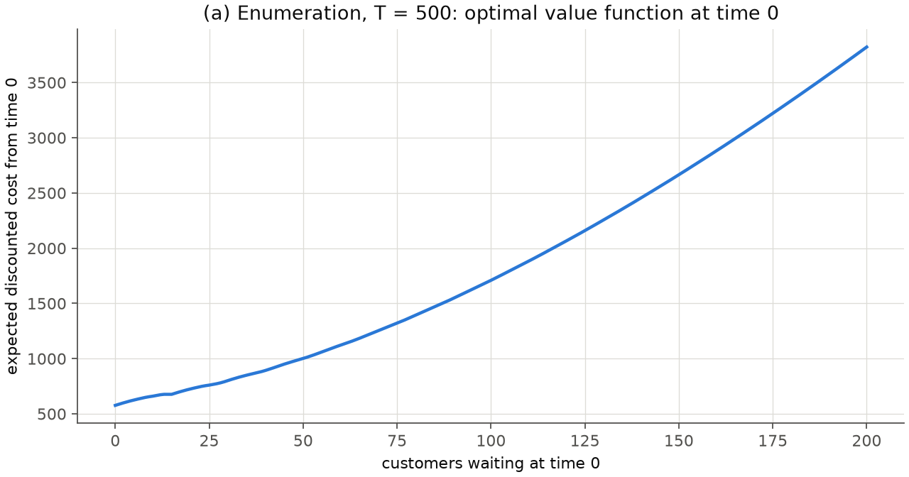{ width=78% }

Figure FIG(fig_a_enumeration_stages) shows the same backward induction at several stages. The curve at $t = 499$ is the one-period cost $2s$, the curve at $t = 495$ still bends only slightly, and the curves for $t \le 400$ are indistinguishable from $t = 0$: with $\gamma = 0.95$ the influence of the horizon decays as $0.95^{500 - t}$.

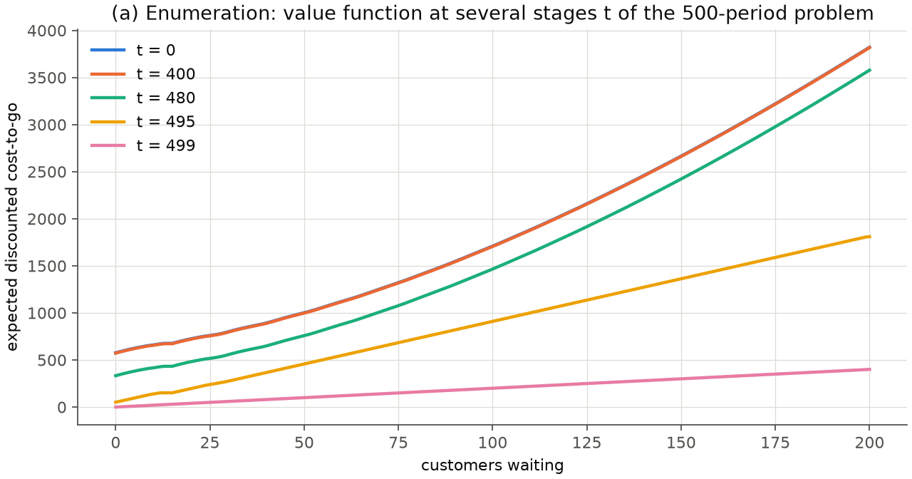{ width=78% }

## (b) Value iteration

Value iteration applies $V \leftarrow \min_a [c_a + \gamma P_a V]$ from $V = 0$ until the sup-norm change is below $10^{-10}$. It stopped after 519 sweeps with a final change of $9.9 \times 10^{-11}$, which bounds the distance to $V^*$ by $\gamma/(1-\gamma)$ times that change, $1.9 \times 10^{-9}$. Figure FIG(fig_b_value_iteration_value) shows $V^*$ and Figure FIG(fig_b_vi_convergence) the geometric convergence (slope $\log 0.95$ per sweep).

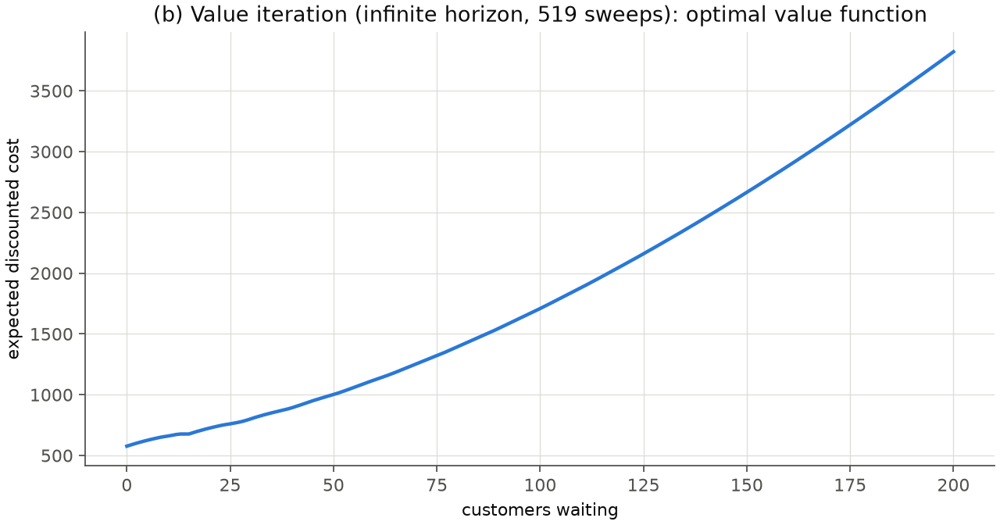{ width=78% }

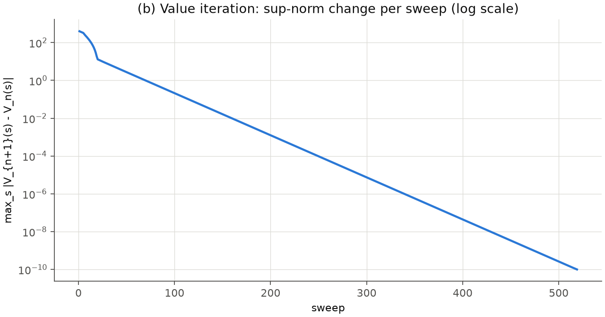{ width=70% }

## (c) Policy iteration

Policy iteration starts from "never dispatch", evaluates each policy exactly by solving $(I - \gamma P_\pi) V = c_\pi$, and improves greedily, changing an action only when it is strictly better. It converged in 6 iterations; the dispatch threshold of the successive policies was 201 (never), 3, 26, 7, 14, 13, 13. The optimal policy (Figure FIG(fig_c_policy_iteration_policy)) is a threshold rule: **dispatch if and only if $s \ge 13$**. Figure FIG(fig_c_q_gap) plots $Q(s, \text{dispatch}) - Q(s, \text{wait})$, which crosses zero between $s = 12$ and $s = 13$.

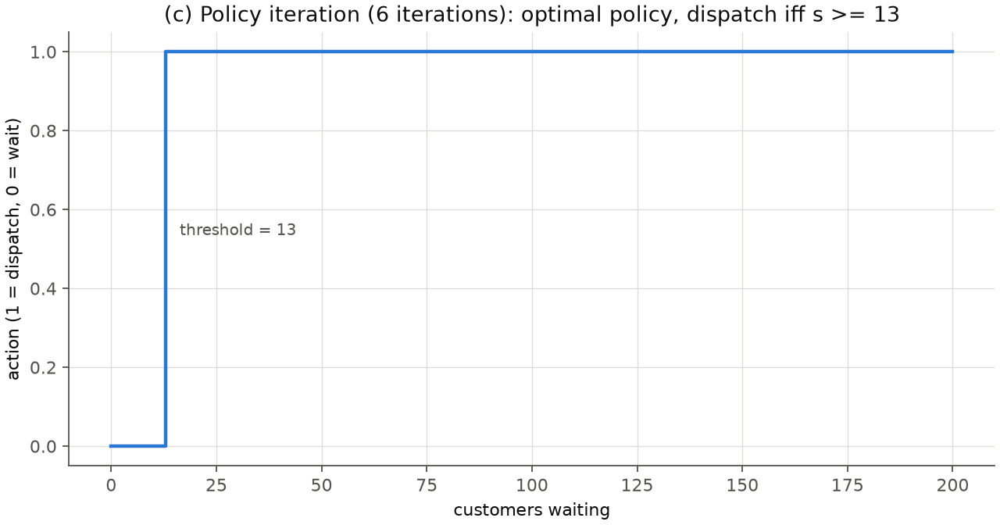{ width=78% }

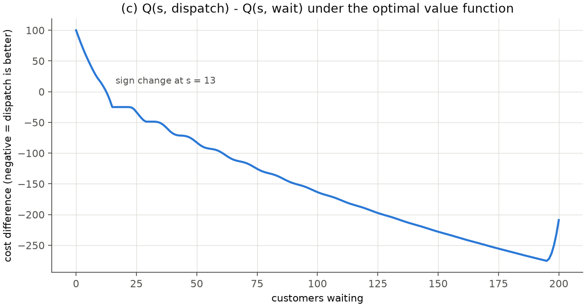{ width=70% }

The threshold is below the capacity: with 13 or 14 customers the shuttle leaves with empty seats. Waiting one more period with 13 customers costs $2 \times 13 = 26$ in holding cost plus the extra cost of a longer queue later, while delaying the dispatch only saves $(1-\gamma) c_f = 5$ in discounting; the exact comparison is the curve in Figure FIG(fig_c_q_gap).

## Agreement between the three methods

The three value functions coincide: $\max_s |V_0^{T=500}(s) - V_{VI}(s)| = 3.1 \times 10^{-9}$ and $\max_s |V_{VI}(s) - V_{PI}(s)| = 1.9 \times 10^{-9}$ (Figure FIG(fig_value_comparison)), and the three policies are identical in every state. The stage policies of the enumeration equal the stationary policy for every $t \le 480$; only the last few stages differ (at $t = 495$ and $t = 499$ the remaining horizon is too short to recover the 100 dispatch cost, so those stages dispatch later or never). That end effect is expected and does not reach $t = 0$.

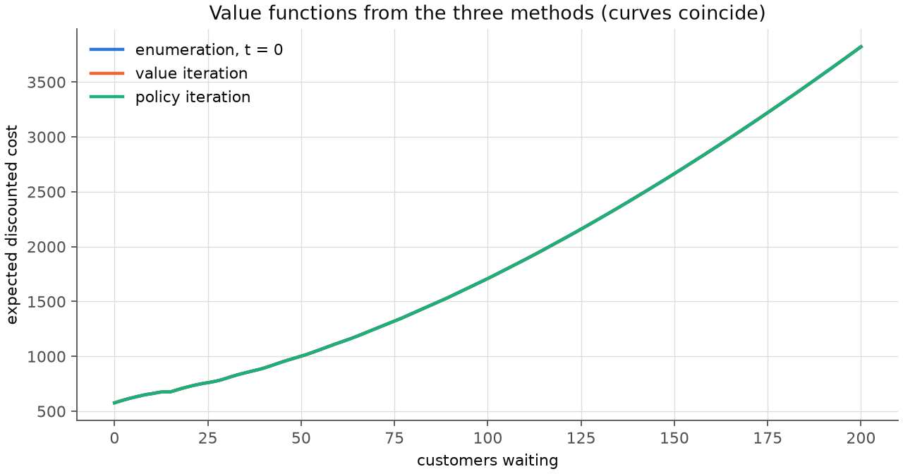{ width=70% }

## Edge cases

- **Empty station ($s = 0$).** Dispatching an empty shuttle costs $c_f$ and changes nothing else, so $Q(0,1) - Q(0,0)$ must equal exactly 100. The computed gap is 100.000000 (test T8).
- **Fewer customers than seats ($s < K$).** $\max(s - K, 0)$ keeps the holding cost at zero and the next state at $A_t$. The solver finds that dispatching with 13 or 14 customers is optimal, so this branch is exercised by the optimal policy itself.
- **The cap at 200.** Rows of $P$ still sum to one (all 402 rows checked); from $s = 199$ and $s = 200$ with "wait" the whole arrival mass lands on 200. Raising the cap to 400 changes $V$ by at most $4.6 \times 10^{-13}$ on $s \le 200$ and leaves the policy unchanged, so the cap does not distort the answer: under the optimal policy the queue never climbs toward 200.
- **Ties in policy improvement.** The improvement step keeps the current action unless the alternative is strictly better by more than $10^{-9}$; this removes cycling between equal-valued actions.
- **Horizon effects.** The finite-horizon problem with $V_T = 0$ makes the last stages myopic (Figure FIG(fig_a_enumeration_stages)). A tolerance of $10^{-10}$ in value iteration and $T = 500$ in enumeration were chosen so that these effects are below $10^{-8}$ at $t = 0$.
- **Monotone structure.** $V^*$ is nondecreasing in $s$ (every increment is between 0 and 24.85) and the policy is monotone (once dispatching is optimal it stays optimal for larger $s$); both are checked in the tests because a bug in the transition model typically breaks them first.

## Tests that validate correctness

`shuttle_mdp/validate_shuttle.py` runs the experiments below and writes `results/shuttle/validation.md`; `tests/test_shuttle.py` contains 14 pytest checks of the same facts with tolerances.

1. **Horizon test (T3).** The error $\max_s |V_0^T - V^*|$ of the $T$-period enumeration is 3420 for $T = 1$, 917 for $T = 10$, 52.2 for $T = 50$, 4.02 for $T = 100$, 0.024 for $T = 200$ and $3.1 \times 10^{-9}$ for $T = 500$. Every value is below the bound $\gamma^T \max_s V^*(s)$ (Figure FIG(fig_val_horizon_error)). With $T = 1$ the value is exactly $2s$ and the policy never dispatches, as a hand calculation requires.
2. **Enumeration of all threshold policies (T4).** Every policy "dispatch iff $s \ge \theta$", $\theta = 0, \dots, 201$, was evaluated exactly. The minimiser is $\theta = 13$ both for $V(0)$ and for the state average, with $V(0) = 576.6702$, equal to the policy-iteration value. Dispatching only when the shuttle is full ($\theta = 15$) costs 597.36, never dispatching costs 2203.91 (Figure FIG(fig_val_threshold_enumeration)).
3. **Monte Carlo policy evaluation (T5).** 20,000 simulated 500-period trajectories of the optimal policy give mean discounted costs of $576.78 \pm 0.43$ from $s = 0$, $676.54 \pm 0.43$ from $s = 13$, $1001.63 \pm 0.43$ from $s = 50$, $1709.29 \pm 0.61$ from $s = 100$ and $3822.37 \pm 1.04$ from $s = 200$ (95% intervals). The Bellman solutions 576.67, 676.67, 1001.53, 1709.04 and 3821.59 all lie inside; the largest z-score is 1.47.
4. **Deterministic arrivals (T7).** With $A_t \equiv 3$ the optimal trajectory from 0 is the cycle 3, 6, 9, 12, 15 and $V(0)$ is a geometric series that can be summed by hand: $(6\gamma + 12\gamma^2 + 18\gamma^3 + 24\gamma^4 + 100\gamma^5)/(1 - \gamma^5) = 569.753019$. The linear-solve value is 569.753019.
5. **Parameter sensitivity (T6, Figure FIG(fig_val_sensitivity)).** The threshold rises with the dispatch cost (8, 11, 13, 14, 15 for $c_f$ = 25, 50, 100, 200, 400; never dispatch at 800), falls with the holding cost (15, 14, 13, 11, 8, 5 for $c_h$ = 0.5, 1, 2, 4, 8, 16), rises with capacity (5, 9, 13, 16, 17, 17 for $K$ = 5, 10, 15, 20, 30, 50) and needs patience: with $\gamma \le 0.5$ the agent never dispatches, because 100 now can never be recovered from at most 30 of holding cost per period, while $\gamma \ge 0.9$ gives threshold 13. Each direction matches the economic reading of the costs.
6. **Agreement and structure (T1, T2, T8, T10)** as described above: stochastic $P$, three identical policies, values equal to $10^{-9}$, exact $c_f$ gap at $s = 0$, insensitivity to the cap, monotone $V^*$ and threshold policy.
7. **First steps of a trajectory.** The table below follows the optimal policy from an empty station (seed 1). The station fills by 1 to 5 customers per period, dispatches as soon as 13 or more wait, and the shuttle leaves 0 customers behind in each of these dispatches.

| t | state | action | boarded | left waiting | cost | arrivals | next state |
|---|---|---|---|---|---|---|---|
| 0 | 0 | wait | 0 | 0 | 0 | 3 | 3 |
| 1 | 3 | wait | 0 | 3 | 6 | 5 | 8 |
| 2 | 8 | wait | 0 | 8 | 16 | 1 | 9 |
| 3 | 9 | wait | 0 | 9 | 18 | 5 | 14 |
| 4 | 14 | dispatch | 14 | 0 | 100 | 2 | 2 |
| 5 | 2 | wait | 0 | 2 | 4 | 3 | 5 |
| 6 | 5 | wait | 0 | 5 | 10 | 5 | 10 |
| 7 | 10 | wait | 0 | 10 | 20 | 3 | 13 |
| 8 | 13 | dispatch | 13 | 0 | 100 | 3 | 3 |
| 9 | 3 | wait | 0 | 3 | 6 | 1 | 4 |
| 10 | 4 | wait | 0 | 4 | 8 | 4 | 8 |
| 11 | 8 | wait | 0 | 8 | 16 | 3 | 11 |

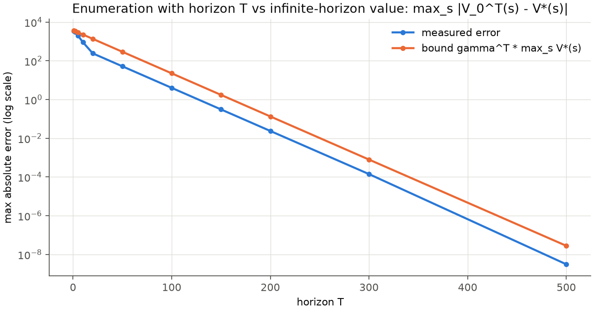{ width=68% }

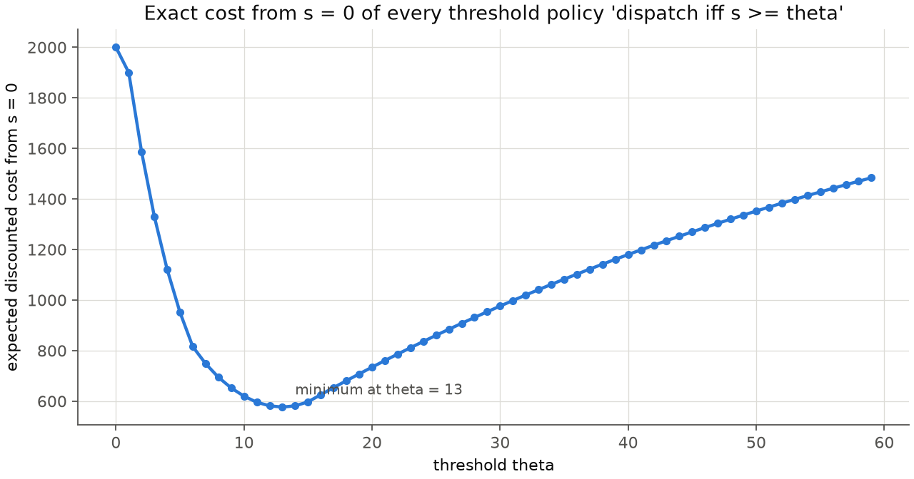{ width=68% }

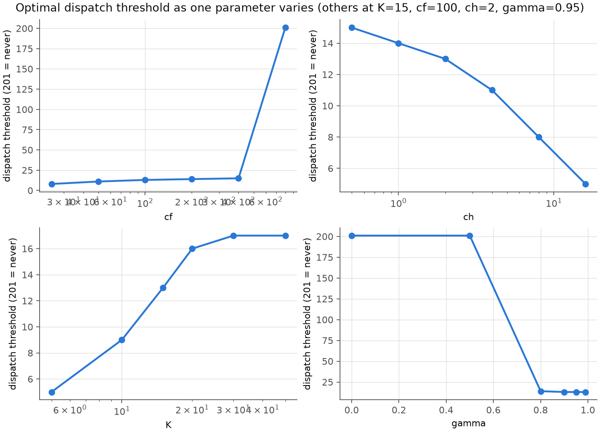{ width=80% }

## With three more months

- Solve the problem with a batch arrival distribution estimated from data (for example a Poisson or an empirical histogram) and with time-varying arrival rates, and test whether the threshold structure survives.
- Verify the structural result analytically: prove that $V^*$ is convex and that the optimal policy is a threshold, then test the solver on random instances against the proof's conditions.
- Compare against average-cost formulations and against a two-shuttle version (state = customers waiting plus shuttles available), where the optimal policy is no longer a single threshold.
- Stress-test numerical settings: tolerances, $T$, and larger caps, with timing, to document how the sweep count of value iteration grows as $\gamma \to 1$ and how policy iteration stays at a handful of iterations.
- Test the robustness of the threshold policy when the true arrival distribution differs from the modelled one (simulate the policy under misspecified arrivals and measure the cost increase).

# Part 3, Policy Gradient Part 1: REINFORCE

## Algorithm

REINFORCE (Williams, 1992) is implemented in PyTorch in `policy_gradient/cartpole_reinforce.py` and `policy_gradient/pong_reinforce.py`. One iteration does the following.

1. Run the current stochastic policy $\pi_\theta$ until the environment terminates or truncates, sampling $a_t \sim \pi_\theta(\cdot \mid s_t)$ from the softmax over the network's logits.
2. Compute the discounted return of every step by the backward recursion $G_t = r_t + \gamma\, G_{t+1}$, $G_T = 0$, so $G_t = \sum_{k \ge t} \gamma^{k-t} r_k$. This is the objective the assignment asks for: the discounted reward over the episode.
3. Take one Adam step on the surrogate loss $L(\theta) = -\sum_t \log \pi_\theta(a_t \mid s_t)\,(G_t - b_t)$, whose gradient is the REINFORCE estimate $\sum_t \nabla_\theta \log \pi_\theta(a_t \mid s_t)(G_t - b_t)$. In Part 1 the baseline is $b_t = 0$; Part 2 uses the baselines described in that section.

**CartPole-v1.** The policy is a 4-128-2 network with ReLU. $\gamma = 0.95$, Adam with learning rate 0.01 as prescribed, one update per episode, 2000 training episodes; smaller learning rates (0.003 and 0.001, 3000 episodes) and a length-normalised loss ($L/T$) were also run because the prescribed setting is unstable (next section). Log-probabilities come from `log_softmax`, which avoids $\log 0$ when the policy becomes nearly deterministic.

**Pong-v5.** `ALE/Pong-v5` from gymnasium 1.4 with ale-py 0.12 and the version's defaults: frame skip 4, sticky actions with probability 0.25, full 6-action space exposed but only RIGHT (2) and LEFT (3) are ever sent (`ACTIONS = [2, 3]`; a counter in the training loop confirms this at the end of every run). Every frame goes through the assignment's `preprocess()` (crop, 2x downsample, background removal, binarise to 80 x 80); the only change is an explicit copy before the in-place operations, because the vector environment hands out views of a shared buffer. The network input is the difference between the current and the previous preprocessed frame (6400 values in $\{-1, 0, 1\}$; the previous frame is all zeros at the first step), which encodes the motion of the ball and paddles that a single frame does not show. The policy is a 6400-200-2 network with ReLU and a softmax over {RIGHT, LEFT}. $\gamma = 0.99$. Four environments run in parallel (`gymnasium.vector.AsyncVectorEnv`); each finished episode is appended to a batch and one Adam step is taken per 10 episodes on the loss averaged over all steps in the batch, with learning rate $10^{-3}$. Trajectories still in flight at update time keep running under the new parameters; their log-probabilities are recomputed at update time, so the gradient is always evaluated at the current parameters, and the resulting slight off-policy error over at most one update is accepted. The prescribed 0.01 was not used: with a 6400-input layer an Adam step of 0.01 per weight equals the initial weight scale (about 0.0125), and the comparison in the Pong section shows that $10^{-3}$ already learns faster than $3 \times 10^{-4}$ and $10^{-4}$. Training is checkpointed every 5 updates and can be resumed. Inputs are stored as int8 and the update processes chunks of 4096 steps, so a batch of 10 long episodes fits in a few hundred MB.

Each run logs every episode (`episodes.csv`) and every update (`updates.csv`: loss, entropy, gradient norm, standard deviation of $G_t$ and of the advantage), and the plots below are produced from these logs by `make_plots_cartpole.py` and `make_plots_pong.py`. The moving average in every training plot is a trailing 100-episode mean (fewer episodes at the start). After training, 500 episodes are rolled out with the trained network, both with sampled actions (the policy as trained) and with greedy actions; the histograms show the sampled roll-outs and the greedy numbers are given in the text.

## CartPole-v1

**Prescribed setting (Adam, learning rate 0.01, $\gamma = 0.95$, 2000 episodes, 5 seeds).** Every seed learns to balance: the 100-episode moving average peaks at 389, 500, 500, 336 and 395, and two seeds reach a moving average of at least 475 (seed 2 at episode 344, seed 1 at episode 1425). No seed stays there. The final moving averages are 37, 159, 9, 46 and 9, and the 500-episode roll-outs of the final networks give means of 62.9, 137.1, 9.4, 9.8 and 9.4 (standard deviations 6.0, 13.1, 0.8, 1.5, 0.8; greedy actions: 64, 136, 9, 10, 9). Three of five seeds end in a collapsed policy that always pushes to one side, which fails after 9 steps, the shortest possible episode; their final entropies are 0.033, 0.148 and 0.000 nats against 0.185 and 0.082 for the two others. Figure FIG(none_lr0.01_seed1_training) shows seed 1 (the best final roll-out) with the required overlay, Figure FIG(none_lr0.01_seed1_hist) its roll-out histogram, and Figure FIG(seeds_none_lr0.01) all five seeds.

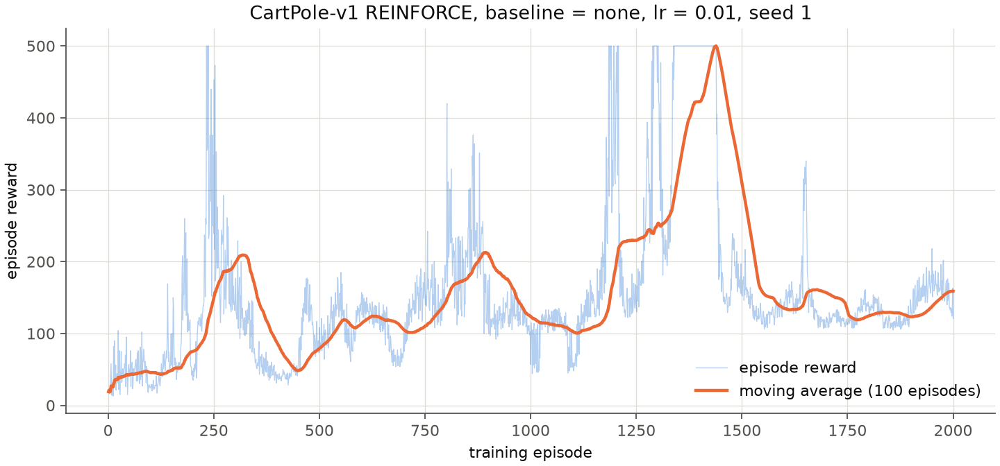{ width=80% }

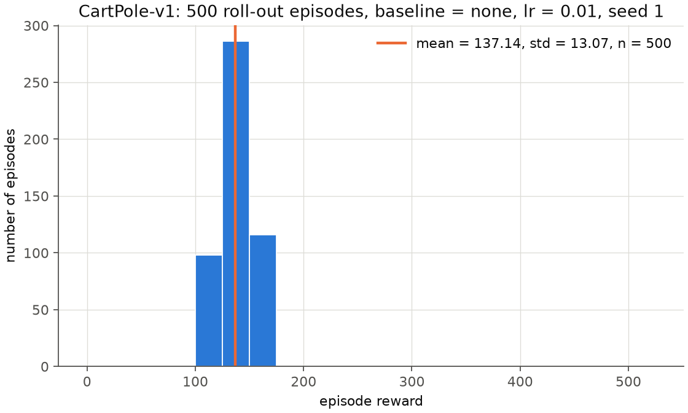{ width=62% }

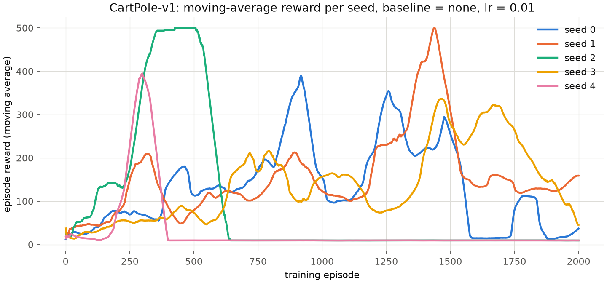{ width=80% }

**Why the prescribed setting collapses.** The surrogate loss is a sum over the episode, so the gradient of a 500-step episode is about 25 times larger than that of a 20-step one, and all returns are positive. Adam divides by a root-mean-square of past gradients with a memory of about 1000 updates, so the first long episodes produce steps far above the recent scale; the policy becomes deterministic (entropy near zero), and once $\pi(a|s) \to 1$ the score function $\nabla \log \pi$ vanishes, so a collapsed one-sided policy is a stationary point from which REINFORCE cannot escape. Dividing the loss by the episode length (`--loss-norm mean`, same learning rate) makes this worse rather than better: roll-out means 9.4, 9.4, 90.1, 9.3, 9.4, because it removes the natural down-weighting of the short, uninformative early episodes.

**Smaller learning rates (3000 episodes, 5 seeds each).** With learning rate 0.003 the peaks are 500, 373, 500, 499, 500 and the final roll-outs 146.7, 181.0, 500.0, 125.7, 71.9 (mean 205.1); no seed collapses to 9, but four of five drift away from 500. With learning rate 0.001 the peaks are 466, 486, 500, 465, 478, the final roll-outs 232.4, 165.0, 400.4, 209.0, 142.0 (mean 229.8; greedy actions 244, 184, 500, 250, 157), no seed collapses, and the curves stay within 120 to 440 after episode 1500 (Figure FIG(compare_lr_none)). Learning rate 0.001 is therefore the setting used as the stable Part 1 reference; its best seed is shown in Figures FIG(none_lr0.001_seed2_training) and FIG(none_lr0.001_seed2_hist) (roll-out mean 400.4, std 142.1 with sampled actions; 500.0 with greedy actions). The remaining gap to 500 with sampled actions is exploration noise of a policy that keeps an entropy of about 0.3 nats, which Part 2 removes.

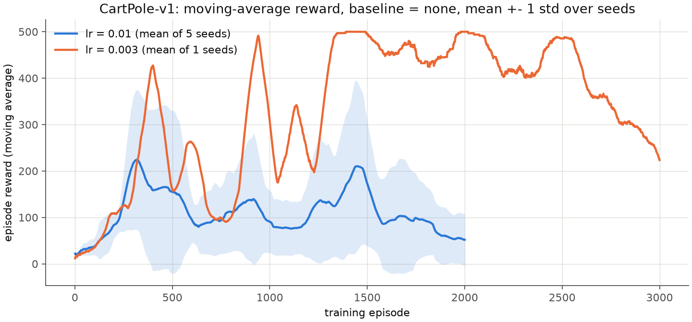{ width=80% }

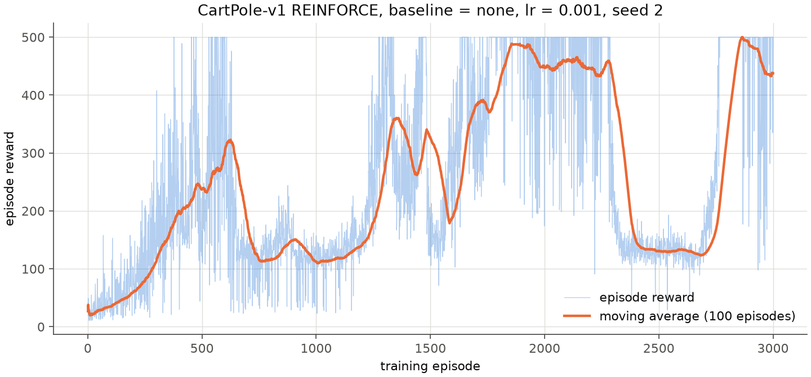{ width=80% }

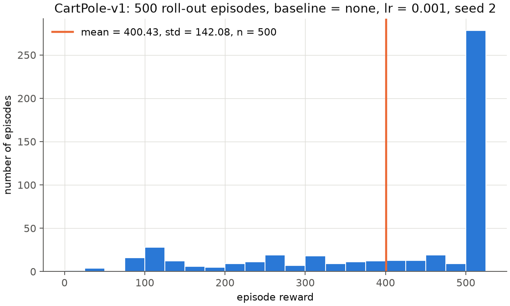{ width=62% }

## Pong-v5

**Compute.** Two runs were trained on the laptop (Apple M5, 10 cores, CPU only; the 2 runs shared the machine with the CartPole sweeps and the laptop throttled to about 1,300 to 2,000 environment steps per second per run) and fifteen runs on the Deepdish node mlds-deepdish5 through Nomad (36 of its 48 CPU cores reserved, no GPU used, `scripts/nomad/`), with 5 seeds for each of no baseline, constant baseline and value baseline. All runs use the same code and hyperparameters: learning rate $10^{-3}$, batches of 10 games, 4 parallel environments, $\gamma = 0.99$, difference-frame input, 6400-200-2 policy.

**Learning rate.** Three no-baseline runs with learning rates $10^{-3}$, $3 \times 10^{-4}$ and $10^{-4}$ were started together on the laptop (Figure FIG(compare_episodes)). After about 816 games the $10^{-3}$ run had a moving average of -20.19 while the two smaller rates were still at -20.35 and -20.28, so the smaller rates were stopped and $10^{-3}$ was kept for every later run. The choice was then checked with 5 seeds per learning rate on the cluster (Figure FIG(compare_lr_groups); 3.3 hours of training for 0.01 and $3 \times 10^{-4}$, 4.0 hours for $10^{-3}$): the final moving averages are -21.0, -21.0, -21.0, -21.0, -21.0 at the prescribed 0.01 (mean -21.0), 10.9, -2.6, 8.0, -1.4, -3.9 at $10^{-3}$ (mean 2.2) and -11.2, -14.3, -11.7, -7.5, -8.6 at $3 \times 10^{-4}$ (mean -10.7); the 500-game roll-outs average -21.0, 2.6 and -10.2 over seeds. At the prescribed 0.01 every seed collapsed within the first hour to a deterministic policy (entropy 0.000) that loses every point in the fewest possible steps, and stayed there for the remaining 27,000 to 30,000 games; its 500-game roll-outs score $-21.0$ in every game. At $3 \times 10^{-4}$ all seeds learn in the same direction as at $10^{-3}$ but more slowly. The prescribed rate is therefore unusable on Pong with this network, and $10^{-3}$ is the largest of the three rates that trains stably.

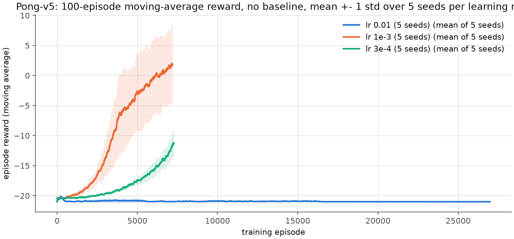{ width=80% }

**Main local run (no baseline).** The run trained for 5.50 hours, 11,508 games and 39.5 million environment steps. The 100-game moving average rose from $-20.4$ to a best value of 9.1 and ended at 8.5 (Figure FIG(none_lr1e-3_training)). The 500-game roll-out of the final network scores 8.30 on average with standard deviation 5.46 (minimum -11, maximum 20; Figure FIG(none_lr1e-3_hist_sampled)); with greedy actions the mean is 9.03 and the standard deviation 5.06. A uniformly random RIGHT/LEFT policy scores -20.10 (standard deviation 0.77; test P3).

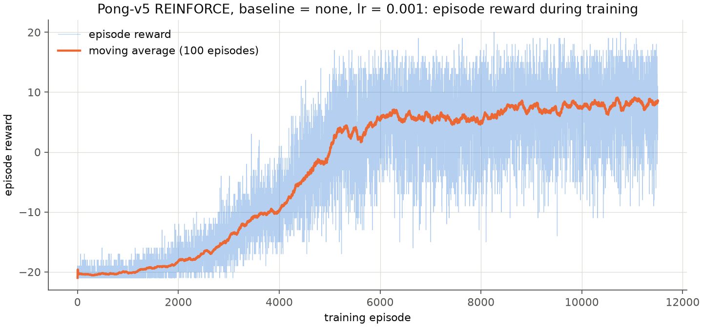{ width=80% }

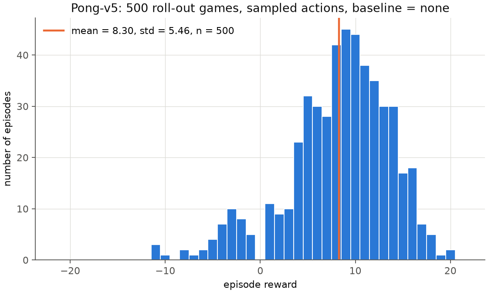{ width=62% }

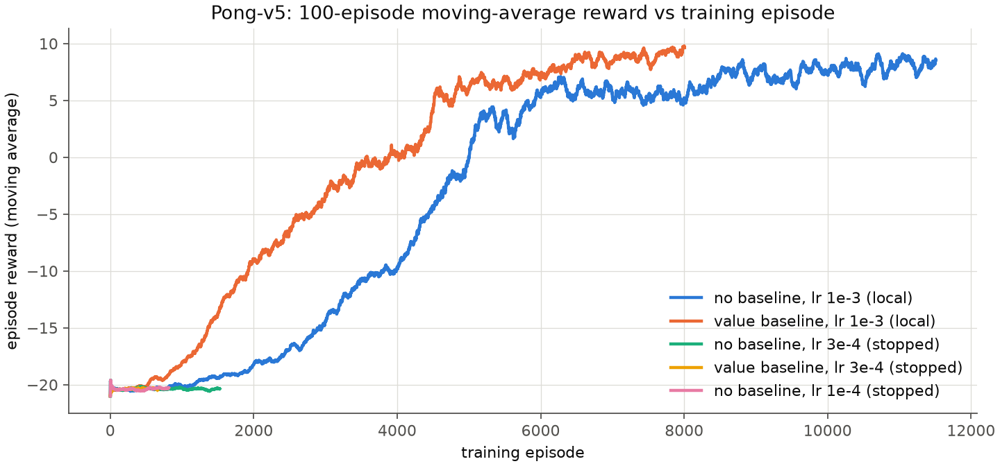{ width=80% }

**Five seeds on the cluster (no baseline).** The five cluster runs trained for 4.0 hours each (7,196 to 8,544 games). Their final moving averages are 10.9, -2.6, 8.0, -1.4, -3.9 (mean 2.2, standard deviation over seeds 6.1) and their 500-game roll-outs 11.2, -2.7, 8.4, -1.2, -2.9 (mean over seeds 2.6). Figure FIG(compare_seed_groups) shows the mean and the spread over seeds next to the two baseline variants of Part 2.

## Edge cases (Part 1)

**CartPole-v1.**

- *Truncation at 500 steps.* CartPole-v1 ends with `truncated = True` after 500 steps. REINFORCE treats that step as the end of the episode and does not bootstrap, so the returns of the last steps before a truncation are smaller than the infinite-horizon values. With $\gamma = 0.95$ a return 60 steps before the cut is within $0.95^{60} \cdot 20 = 0.9$ of its untruncated value, so only the tail of a perfect episode is affected, and all those returns stay positive. The roll-out statistics count a 500-step episode as reward 500.
- *All rewards are +1.* Without a baseline every $G_t$ is positive, so every sampled action is reinforced; learning only comes from differences between the returns of different steps and episodes. This is the main source of variance and is quantified in Part 2.
- *Short early episodes and the return scale.* The first episodes last 8 to 30 steps and $G_t \le 1/(1-\gamma) = 20$ for every $t$; a 20-step survival already gives $G_0 = 12.8$ and a 500-step one gives 20.0 (validation V5). The learning signal therefore only distinguishes the next 20 to 60 steps, which is enough for balancing but makes the objective nearly flat once episodes are long.
- *Growing gradient scale and collapse.* The episode gradient is a sum over $T$ steps with returns up to 20, so its scale grows by a factor of about 25 between a 20-step and a 500-step episode. Adam normalises by a running root-mean-square with a memory of about 1000 updates, so when episodes suddenly become long the steps become too large. The policy then becomes deterministic ($\text{entropy} \to 0$; the gradient $\nabla \log \pi(a|s) \to 0$ when $\pi(a|s) \to 1$), and a policy that collapsed onto a bad action cannot recover because its gradient vanishes. This is observed in 3 of 5 seeds at learning rate 0.01 (final roll-out mean 9.4, always pushing to one side) and motivates the smaller learning rate and the length-normalised loss reported below.
- *Numerical safety.* Log-probabilities are computed with `log_softmax` and actions are sampled from `Categorical(logits=...)`, so a near-deterministic policy never produces $\log 0$ or a NaN gradient; a zero advantage gives an exactly zero gradient (unit test).
- *Seed dependence.* Results differ a lot between seeds, so every configuration was run with 5 seeds and the comparison plots show the mean and standard deviation across seeds rather than one run.

**Pong-v5.**

- *Automatic reset inside the vector environment.* With gymnasium 1.4 the step after a terminal step returns the first observation of the next game, ignores the action and gives reward 0. That step must not be recorded as a transition and the difference frame must restart from an all-zero previous frame; the `FrameTracker` class handles it, a unit test exercises the sequence (terminal step, reset step, first real step), and the training loop asserts after every episode that its own episode reward and length equal the ones reported by gymnasium's `RecordEpisodeStatistics` wrapper (no mismatch occurred in about 22,516 episodes).
- *First frame of a game.* There is no previous frame, so the input is the first frame itself; this is the only input that shows the static paddles, and a test checks it.
- *In-place preprocessing.* The assignment's `preprocess()` edits its input in place; applied to the shared observation buffer of the vector environment it would corrupt later observations, so the function first copies the crop. A test checks that the frame is unchanged after preprocessing.
- *Two of six actions.* Only indices 0 and 1 of the policy exist, mapped to environment actions 2 (RIGHT, measured to move the paddle up) and 3 (LEFT, down). Pong serves automatically, so FIRE is not needed; the action counter at the end of each run confirms that no other action was sent, and every recorded game reached 21 points for one side.
- *Sticky actions.* `Pong-v5` repeats the previous action with probability 0.25 regardless of the agent's choice. The recorded action is the one the agent sampled, which is the correct quantity for the policy gradient; the repetition is part of the environment's transition noise and makes the game stochastic even for a fixed seed.
- *Sparse rewards and long episodes.* Rewards are $\pm 1$ at the 21 to 41 points of a game and 0 elsewhere; a game lasts from about 800 steps (losing 21-0 quickly) to several thousand steps once rallies get longer. $G_t$ is computed over the whole episode as required, but with $\gamma = 0.99$ a point's reward is discounted by 0.37 after 100 steps, so each return is dominated by the next point (validation P4 shows the sawtooth). Inputs are stored as int8 and the update works in chunks, so a batch of 10 long games fits in memory.
- *In-flight trajectories at update time.* With four parallel games, up to three games are unfinished when the batch of 10 completes; they continue under the updated policy and are used with log-probabilities recomputed at their own update, so the gradient is always taken at the current parameters and the data is at most one update old.
- *Frame limit.* The environment also truncates a game after 108,000 frames (27,000 steps); this never happened (the longest recorded game had 8,563 steps) and would be treated like a terminal step.

## Tests that validate correctness (Part 1)

`tests/test_policy_gradient.py` (11 pytest checks) covers the mechanics; `policy_gradient/validate_cartpole.py` (V1 to V6) and `policy_gradient/validate_pong.py` (P1 to P7) run the experiments below and write `validation.md` in the results folders.

**CartPole-v1.**

1. **Unit checks.** The discounted-return recursion equals a brute-force double sum on random reward sequences and gives $[1.75, 1.5, 1]$ for rewards $[1,1,1]$ with $\gamma = 0.5$. One Adam step on two copies of the same state with advantages $+1$ for action 0 and $-1$ for action 1 raises $\pi(0|s)$. A zero advantage gives an exactly zero gradient on every parameter.
2. **Random-policy level (V1).** 500 episodes of an untrained network score $20.3 \pm 10.4$ (max 97), the known level of a random CartPole policy, so the environment loop and the sampling are correct and every learning curve starts at the right place.
3. **Sign and magnitude of the update (V2, Figure FIG(fig_val_controls)).** Three 300-episode runs from the same seed: with learning rate 0 the 20-episode average stays at the random level (20.2 in the first 50 episodes, 18.9 in the last 50); with the normal update it rises from 25.8 to 65.7; with the advantages negated it falls from 12.4 to 9.2, the shortest possible episode. Flipping the sign of the estimator produces the mirror-image behaviour, which a wrong gradient would not.
4. **Physical sanity of the learned policy (V4, V4b).** For the best trained network (value baseline, learning rate 0.001, seed 2, roll-out 500.0) the mirror test on 2000 visited states gives $|P(\text{right}|s) - P(\text{left}|-s)| = 0.053$ on average with correlation 0.997 between the two probabilities; the dynamics are mirror symmetric, so this is the expected result. On 8 states with the pole clearly falling ($|\theta| \ge 0.1$ rad and $|\dot\theta| \ge 1$ rad/s in the same direction) the policy pushes toward the fall with probability at least 0.9997 in every state (untrained network: 0.45). An earlier checkpoint with the same roll-out score of 500.0 (value baseline, learning rate 0.01, seed 0) failed the mirror test (mean difference 0.49, correlation 0.10): it balanced by dithering around a bias and reacting only to larger deviations. Two policies with the same score therefore differ in quality, and the symmetry test separates them.
5. **Return scale (V5).** The largest $G_t$ over 20 trained episodes is 20.000, the bound $1/(1-\gamma)$; the implementation never exceeds it and the learning signal is local as described above.
6. **Step-by-step trace (V6).** The table below lists the first 10 steps of the trained policy. $P(\text{right})$ follows the sign of $\dot\theta$: 0.07 when $\dot\theta = -0.28$ rad/s, 0.88 to 0.99 when $\dot\theta$ is between $+0.22$ and $+0.55$ rad/s, and about 0.3 to 0.5 when the pole is nearly still, which is how a balancing controller must behave.
7. **Collapse diagnosis.** The three collapsed seeds at learning rate 0.01 end with policy entropy 0.000 to 0.033 nats and roll-out standard deviation below 1.5, against entropies 0.08 to 0.19 for the seeds that kept a working policy; the collapse is a deterministic one-sided policy, not a logging or evaluation error, and the greedy roll-outs (9 to 10) confirm it.
8. **Seeds and repeats.** Every configuration was run with 5 seeds (12 configurations, 60 runs), so every claim above rests on a distribution rather than one run.

| t | x | x_dot | theta | theta_dot | P(right) | action | reward |
|---|---|---|---|---|---|---|---|
| 0 | -0.020 | +0.037 | -0.049 | +0.032 | 0.48 | right | 1 |
| 1 | -0.019 | +0.233 | -0.049 | -0.276 | 0.07 | left | 1 |
| 2 | -0.015 | +0.039 | -0.054 | +0.001 | 0.39 | left | 1 |
| 3 | -0.014 | -0.156 | -0.054 | +0.276 | 0.88 | left | 1 |
| 4 | -0.017 | -0.350 | -0.049 | +0.551 | 0.99 | right | 1 |
| 5 | -0.024 | -0.154 | -0.038 | +0.244 | 0.87 | right | 1 |
| 6 | -0.027 | +0.042 | -0.033 | -0.061 | 0.31 | left | 1 |
| 7 | -0.026 | -0.153 | -0.034 | +0.221 | 0.84 | right | 1 |
| 8 | -0.029 | +0.043 | -0.030 | -0.082 | 0.28 | left | 1 |
| 9 | -0.028 | -0.152 | -0.031 | +0.201 | 0.82 | right | 1 |

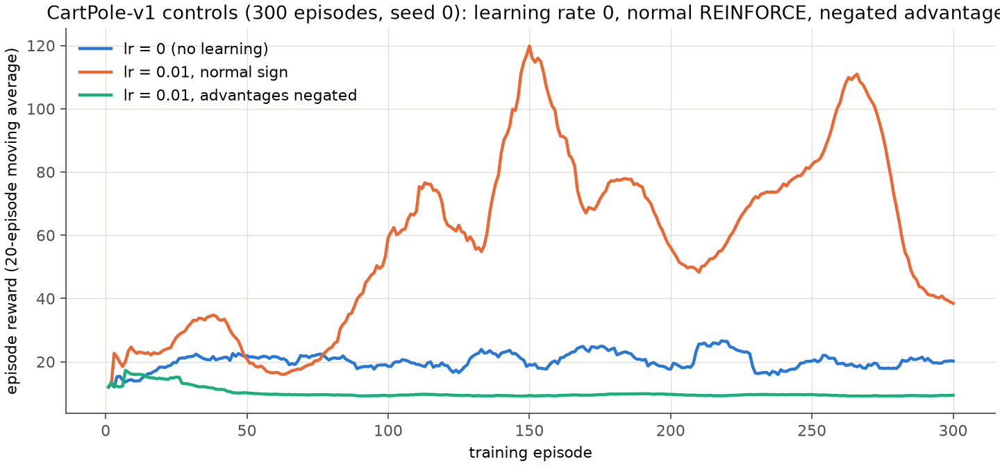{ width=78% }

**Pong-v5.**

1. **Preprocessing (P1, Figure FIG(fig_val_pong_preprocess)).** A mid-rally frame keeps 34 of the 6400 pixels (two paddles and the ball), all values are 0 or 1, and the difference frame has 16 nonzero entries: the moving objects only. The unit tests check the shape, the binary values and that the input frame is left unchanged.
2. **Action semantics (P2).** Holding action 2 (RIGHT) for 15 steps moves the agent's paddle from row 34.5 to row 1.0 of the 80 x 80 image; holding action 3 (LEFT) moves it from 34.5 to 78.5. Row 0 is the top, so RIGHT is up and LEFT is down; the behaviour probe below relies on this.
3. **Random policy and game structure (P3).** 20 games with uniformly random RIGHT/LEFT score -20.10 on average (standard deviation 0.77, best -19, mean length 1105 steps). Every game ended when one side reached 21 points, the last reward was nonzero and all rewards were in $\{-1, 0, 1\}$; the same structural assertions run on every game inside the training loop, and the loop also asserts that its own episode reward and length equal gymnasium's `RecordEpisodeStatistics` values. These assertions held for all 22,516 training games of the local runs. The action counters at the end of the runs show only actions 2 and 3 (for the main no-baseline run RIGHT 404,648 times and LEFT 440,448 times).
4. **Discounted return along a game (P4, Figure FIG(fig_val_pong_returns)).** Over a 5,857-step game of the trained policy $G_t$ ranges in [-1.95, 1.55]; at the first lost point $G_t$ = -0.299 and ten steps earlier -0.271, a ratio of 0.904 against $0.99^{10} = 0.904$ expected when no other point is near. The sawtooth shape shows that each return is dominated by the next point even though it is computed over the whole game.
5. **Behaviour probe (P5).** On frames where both the ball and the agent's paddle are visible, the trained policy chooses "up" with probability 0.519 when the ball is above the paddle and 0.296 when it is below (difference +0.223, 12,014 and 4,143 frames); the untrained network gives 0.482 and 0.482. The agent moves the paddle toward the ball, which is the behaviour the score requires and which the pixels alone do not reveal.
6. **First steps of a game (P7).** The first input of a game holds the full first frame (18 nonzero pixels, both paddles) and later inputs only the moving pixels (3 to 20 nonzero entries); the table in `results/pong/validation/validation.md` lists the first 10 inputs, action probabilities and actions.
7. **Longest game and truncation.** The longest recorded game had 8,563 steps, far below the 27,000-step frame limit, so no game was truncated.

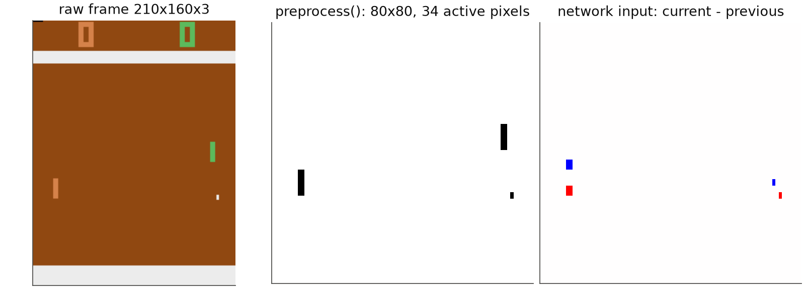{ width=90% }

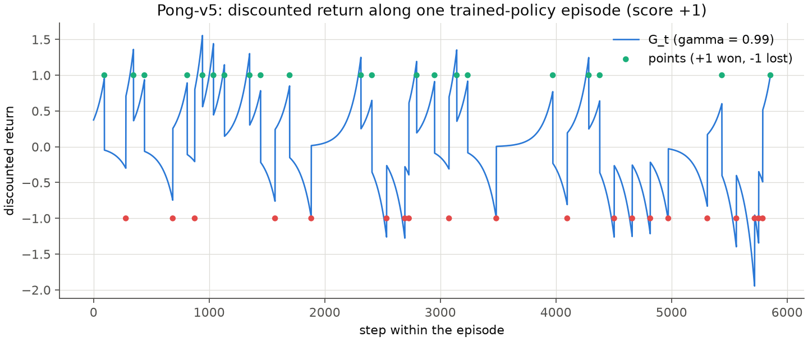{ width=80% }

## With three more months (Part 1)

- Run every Pong configuration with at least 5 seeds (only one seed per configuration fit in the time available) and report confidence bands on the learning curves and on the time to reach a given score.
- Validate the gradient estimator on a problem with a known exact gradient: a two-state bandit or a small gridworld where $\nabla_\theta J(\theta)$ can be computed from the MDP, and compare the REINFORCE estimate (same code path) with the exact gradient and with a finite-difference estimate of $J$.
- Compare against a reference implementation (for example CleanRL) on CartPole with identical seeds and hyperparameters; identical learning curves would rule out implementation errors that only show up as slower learning.
- Study the CartPole collapse in detail: log Adam's second-moment statistics and the parameter change per update, then test gradient clipping, learning-rate decay and an entropy bonus, and map the region of learning rates and loss scalings where the collapse disappears.
- Evaluate during training with a fixed set of evaluation seeds and greedy actions, so that the reported curve measures the policy rather than the exploration noise.
- Pong ablations: difference frame vs. a stack of 2 to 4 frames, a small convolutional policy, $\gamma \in \{0.95, 0.99, 0.999\}$, batch sizes 1 to 40 episodes, restarting the return at every point (Karpathy's trick) vs. the full-episode return, and sticky actions off, to measure how much of the roll-out spread is environment noise.
- Robustness tests of the trained Pong policy: horizontally mirrored frames, random no-op starts, a different frame skip, and an opponent with a different difficulty setting.
- Train Pong until the agent wins consistently (score above 0) and record the number of frames needed, then profile and parallelise the collection (more environments, GPU for the update) since compute was the binding constraint here.

# Policy Gradient Part 2: REINFORCE with a baseline

## Baselines used

Two baselines are implemented in the same scripts (`--baseline mean` and `--baseline value`); both leave the gradient unbiased because neither depends on the action taken at step $t$.

- **Constant baseline** (`mean`): $b$ is an exponential moving average of the mean discounted return. CartPole updates it once per episode with rate 0.05 (initialised with the first episode's mean $G_t$); Pong updates it once per batch of 10 episodes with rate 0.1.
- **Learned state-value baseline** (`value`, the main choice for Part 2): a second network $V_\phi(s)$ with the same architecture as the policy but one output (4-128-1 for CartPole, 6400-200-1 for Pong). The advantage is $A_t = G_t - V_\phi(s_t)$ with $V_\phi$ detached, computed with the parameters $\phi$ from *before* the current update so that the baseline is a function of the state only. After the policy step, $\phi$ is fitted to the Monte Carlo targets $G_t$ by least squares: 5 Adam steps (learning rate equal to the policy's) on the episode for CartPole, and 2 passes over the batch in minibatches of 2048 steps with learning rate $10^{-3}$ for Pong. The policy update is otherwise identical to Part 1, including the learning rates.

The learned baseline removes the part of $G_t$ that is predictable from the state (how long the pole is likely to survive from here; whether the ball is about to pass the paddle), so the remaining advantage reflects the effect of the action. The constant baseline only removes the common level of the returns. Both reductions are measured directly in the tests below.

## CartPole-v1 with a baseline

With the learned value baseline at the prescribed learning rate 0.01, every seed reaches a moving average of at least 475 (at episodes 500, 474, 792, 271 and 488, against 2 of 5 seeds without a baseline), the final roll-outs are 500.0, 500.0, 315.9, 500.0 and 9.3 (mean 365.0; greedy actions 500, 500, 318, 500, 9), and one seed collapses late in training. The constant baseline at the same learning rate reaches 475 in every seed (episodes 481, 808, 1278, 171, 369), never collapses, and rolls out at 226.5, 500.0, 394.8, 500.0 and 421.8 (mean 408.6). Figure FIG(compare_baselines_lr0.01) compares the three variants at learning rate 0.01, Figures FIG(value_lr0.01_seed0_training) and FIG(value_lr0.01_seed0_hist) show the value-baseline run of seed 0 with its roll-out histogram (500.0 in all 500 episodes).

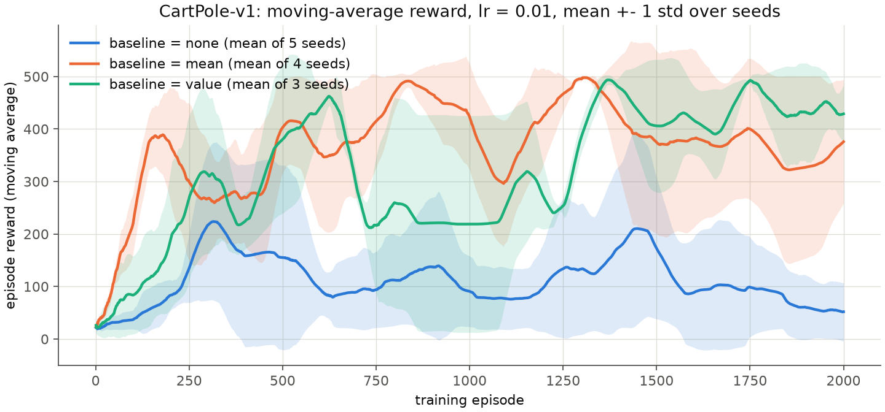{ width=80% }

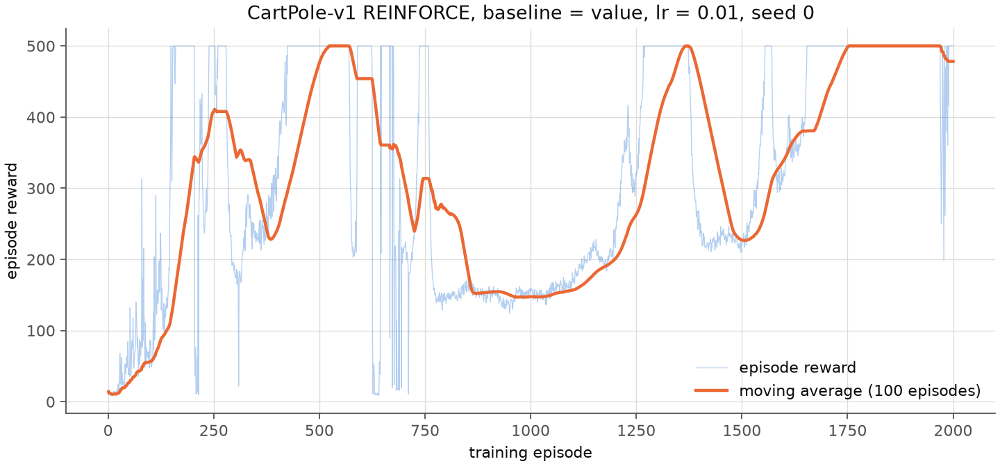{ width=80% }

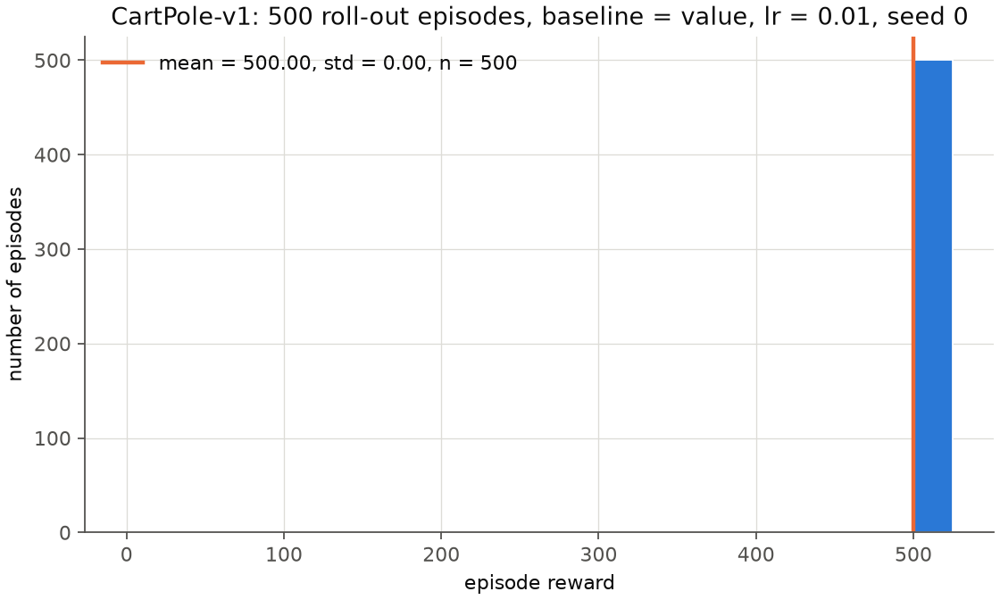{ width=62% }

The table gives the mean over seeds of the 500-episode roll-out mean for every configuration (3000 training episodes for learning rates 0.003 and 0.001, 2000 otherwise).

| baseline | lr 0.01 | lr 0.01, loss / T | lr 0.003 | lr 0.001 |
|---|---|---|---|---|
| none | 45.7 (3 of 5 collapsed) | 25.5 (4 of 5 collapsed) | 205.1 | 229.8 |
| constant (mean return) | 408.6 | 499.4 | 500.0 | 452.8 |
| learned V(s) | 365.0 (1 collapsed) | 368.8 | 383.4 | 481.5 |

The constant baseline with learning rate 0.003 solves the task in all five seeds (roll-outs 499.9, 500.0, 500.0, 500.0, 500.0; Figures FIG(mean_lr0.003_seed1_training) and FIG(mean_lr0.003_seed1_hist)), and the learned value baseline with learning rate 0.001 gives 493.4, 499.8, 500.0, 415.8, 498.7 (greedy actions 500, 500, 500, 489, 500; Figure FIG(compare_baselines_lr0.001)). On CartPole the constant baseline is the more reliable of the two at large learning rates because the value network, fitted on one episode at a time, is itself noisy during the first few hundred episodes and adds variance until it converges; the gradient-variance measurements in the tests below show that both baselines remove about 98 percent of the estimator variance once the policy is good.

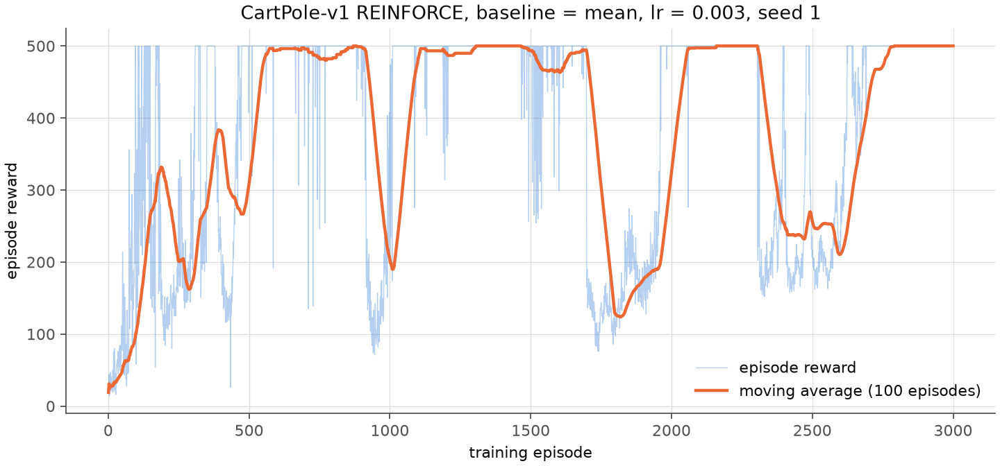{ width=80% }

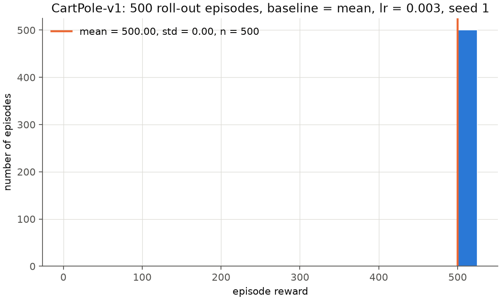{ width=62% }

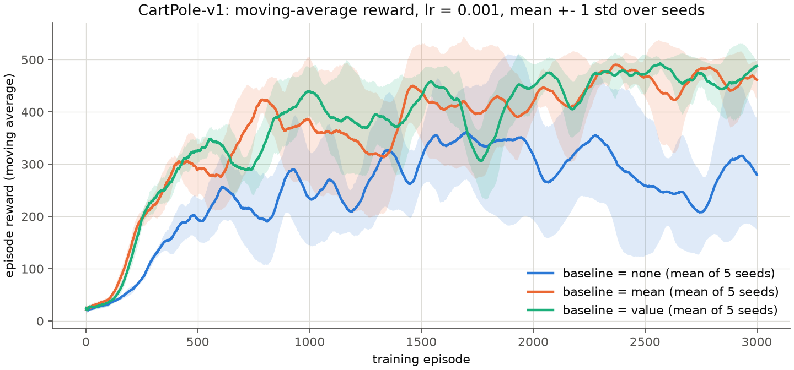{ width=80% }

## Pong-v5 with a baseline

**Main local run (value baseline).** With the same learning rate and batch size the value-baseline run trained for 5.30 hours, 8,005 games and 36.0 million steps; its moving average reached a best of 9.8 and ended at 9.6 (Figure FIG(value_lr1e-3_training)). The 500-game roll-out scores 9.57 on average with standard deviation 3.97 (minimum -4, maximum 19; Figure FIG(value_lr1e-3_hist_sampled)); with greedy actions 10.18 and 3.63. Figure FIG(compare_env_steps) compares the two local runs on the same number of environment steps and Figure FIG(compare_wall_time) on wall-clock time: the no-baseline run first reaches a moving average of 0 after 11.6 million steps (4,996 games) and the value-baseline run after 12.9 million steps (3,565 games); for a moving average of +5 the numbers are 15.0 million steps (5,824 games) against 18.3 million steps (4,516 games). Counted in games the baseline run is ahead, counted in environment steps the two are close, because the baseline run's rallies get longer sooner and each of its games costs more steps. Both runs are single seeds, so the five-seed cluster comparison below is the one to read for the size of the effect.

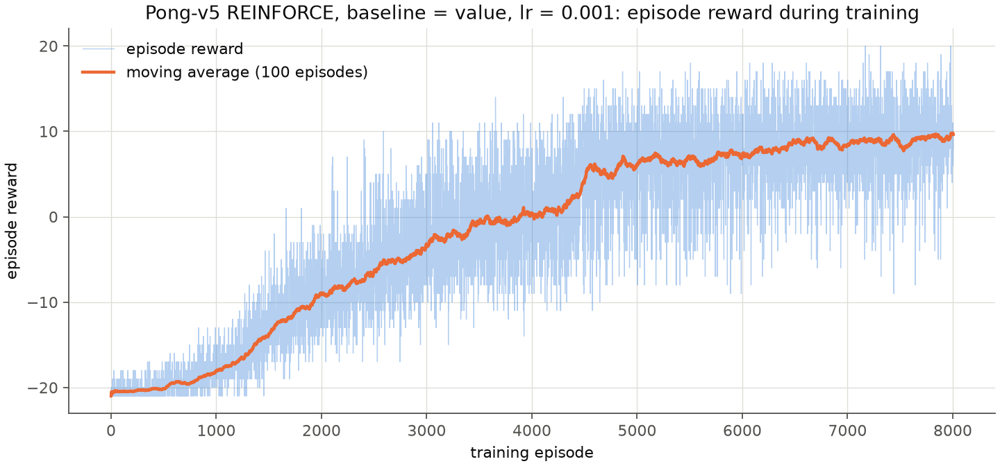{ width=80% }

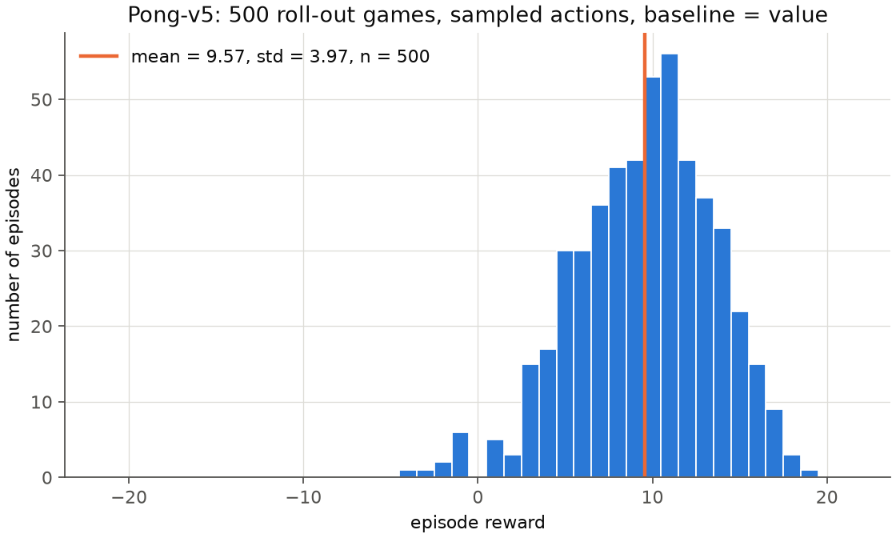{ width=62% }

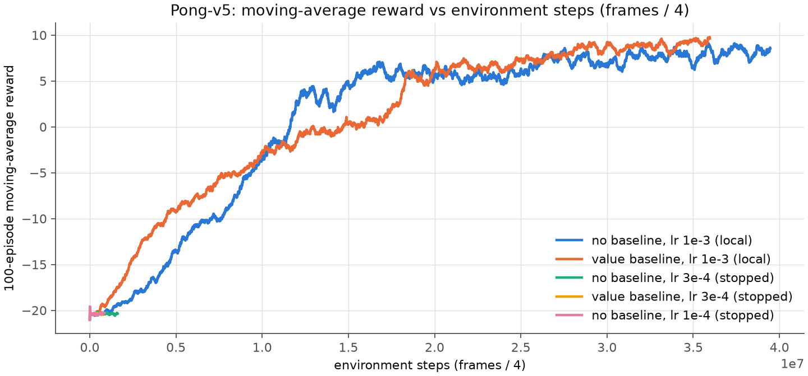{ width=78% }

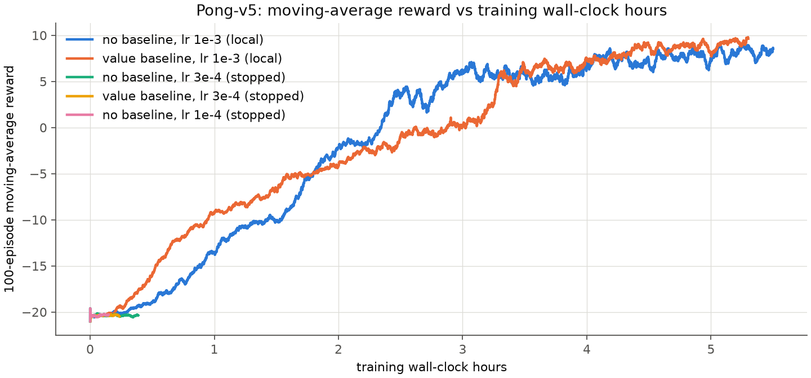{ width=78% }

**Five seeds per variant on the cluster.** Figure FIG(compare_seed_groups) and the table give the cluster results after 4.0 hours of training per run.

| variant (5 seeds each) | games per seed | final MA100 per seed | final MA100 mean (std over seeds) | roll-out mean per seed (500 games, sampled actions) | roll-out mean over seeds |
|---|---|---|---|---|---|
| no baseline | 7,196 to 8,544 | 10.9, -2.6, 8.0, -1.4, -3.9 | 2.2 (6.1) | 11.2, -2.7, 8.4, -1.2, -2.9 | 2.6 |
| constant baseline | 5,444 to 6,915 | 10.1, -1.2, -1.4, 12.8, 3.8 | 4.8 (5.8) | 9.9, -0.8, -0.3, 12.9, 3.7 | 5.1 |
| value baseline | 4,443 to 5,782 | 2.5, 11.6, -0.1, 1.2, 12.3 | 5.5 (5.3) | 1.8, 11.6, 0.6, 1.1, 12.8 | 5.6 |

All three variants learn with identical hyperparameters and no seed collapsed (final policy entropies 0.11 to 0.20 nats). A moving average of $-10$ is reached after a median of 3,491 games without a baseline, 1,730 with the constant baseline and 1,687 with the value baseline; a moving average of 0 is reached by 2, 4 and 5 of the 5 seeds (median 3,861, 3,335 and 3,329 games among those that reach it). The baseline runs need fewer games to reach each level, while the number of games played in 4 hours is smaller for them because their rallies get longer sooner. The spread between seeds (standard deviations of the final moving average 6.1, 5.8 and 5.3) is of the same size as the difference between variants, which is why one seed per variant, as on the laptop, is not enough to rank them.

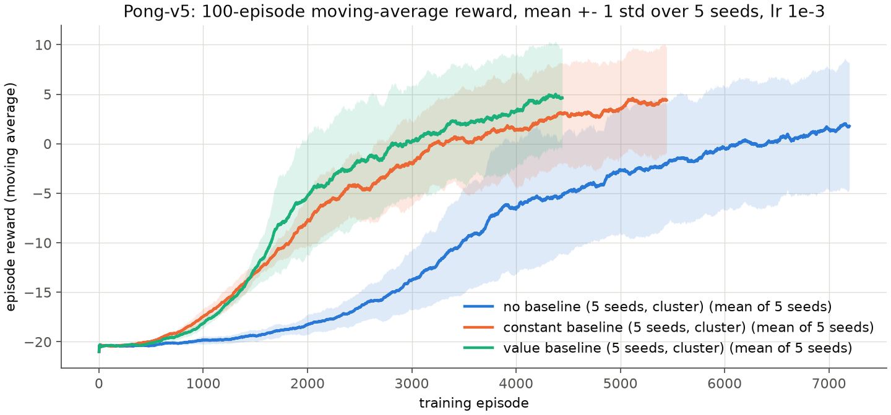{ width=82% }

## Edge cases (Part 2)

- **A baseline that depends on the action biases the gradient.** A value network fitted on the current episode before computing its advantages would make $b_t$ a function of the sampled actions. The implementation computes the advantages with the parameters from before the update and fits the network afterwards, so $b_t$ depends on the state and on past episodes only. The gradient-variance test checks that the mean gradient keeps its direction (cosines 0.93 to 0.95 with the no-baseline mean at the trained policy).
- **An untrained value network adds noise.** In the first episodes $V_\phi$ is random, so $G_t - V_\phi(s_t)$ can have a larger spread than $G_t$ itself; the measured reduction is 4.0x at the untrained policy and 52x at the trained one. This is why the value baseline at learning rate 0.01 still loses one seed on CartPole while the constant baseline loses none.
- **Initialising the constant baseline.** The moving average starts at the first episode's mean return (not at 0); a baseline far below the current returns would recreate the all-positive-advantage situation of Part 1. The rate 0.05 per episode (0.1 per batch on Pong) follows the rising returns, from about 10 to 20 on CartPole.
- **Near-zero gradient at the solution.** With the returns bounded by 20, a good baseline makes $G_t - b_t \approx 0$ in every state once the policy is good, and the update stops growing with the episode length. The measured norm of the mean gradient at the trained policy is 94 without a baseline and 8 to 10 with either baseline; the first keeps pushing the policy toward determinism, the second does not, which is why the collapses disappear.
- **Pong value network.** A 6400-input regression on 10 games can overfit; the network is fitted for only 2 passes per batch, its loss is logged in `updates.csv`, and the standard deviation of the advantage is logged next to that of $G_t$ so the variance reduction is visible during training (Figure FIG(compare_advantage_std) in the Pong section). The constant baseline on Pong tracks the batch mean of $G_t$, which moves from about $-2$ early in training toward 0 as the agent wins points.
- **Truncated episodes.** The value targets on CartPole are the truncated returns, consistent with the policy objective; near the 500-step cap $V_\phi$ learns the shortened returns and the advantages stay centred.

## Tests that validate correctness (Part 2)

**CartPole-v1.**

1. **Variance of the gradient estimate (V3, Figure FIG(fig_val_gradient_variance)).** Per-episode REINFORCE gradients were computed for the same sampled episodes with the three advantage choices (same policy, same actions). At an untrained policy (200 episodes, mean reward 20) the trace of the gradient covariance is 5212 with no baseline, 1954 with the constant baseline (2.7x smaller) and 1309 with the learned value baseline (4.0x smaller); the signal-to-noise ratio of the 200-episode average gradient rises from 3.0 to 4.8 and 6.4. At the trained policy (100 episodes, mean reward 500) the traces are 792,725, 15,211 and 15,200: both baselines remove 98 percent of the variance (52x). The cosines between the mean gradients and the no-baseline mean are 0.80 and 0.76 (untrained) and 0.95 and 0.93 (trained), consistent with an unchanged expectation given the sampling noise.
2. **Outcome across seeds.** At learning rate 0.01, collapses drop from 3 of 5 seeds to 0 of 5 (constant) and 1 of 5 (value), and the moving average reaches 475 in 5 of 5 seeds with either baseline against 2 of 5 without. The table in the previous section gives the roll-out means for all 12 configurations.
3. **Same tests as Part 1.** The Part 2 policies pass the mirror test (mean difference 0.053, correlation 0.997) and the obvious-state test (probability of pushing toward the fall at least 0.9997 in all 8 states); the Part 2 code paths share the return, loss and roll-out code with Part 1, so the unit checks apply unchanged.

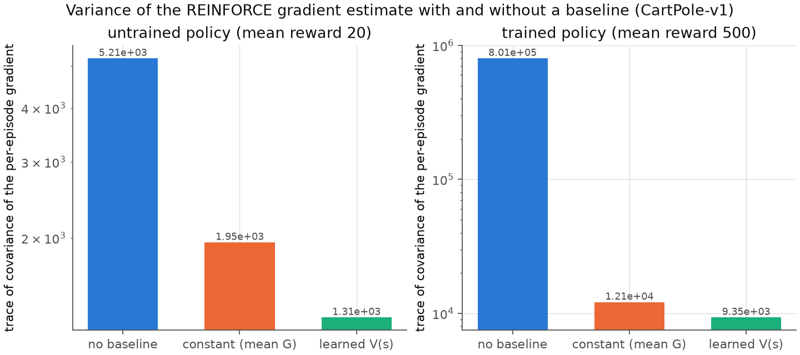{ width=85% }

**Pong-v5.**

1. **Spread of the advantage during training (Figure FIG(compare_advantage_std)).** Every update logs the standard deviation of $G_t$ and of the advantage over the batch. Without a baseline the two coincide by definition. With the value baseline the advantage spread is 0.69 times the spread of $G_t$ over the last 50 updates (average 0.38 against 0.55), so the value network explains most of the predictable part of the return; the remaining spread is the effect of the actions and of the sticky-action noise, which no state-dependent baseline can remove.
2. **Variance of the gradient estimate (P6).** For 12 games of the Part 2 policy (mean score 9.3) the trace of the per-game gradient covariance is 0.000811 with no baseline, 0.000768 with the constant baseline (1.1x smaller) and 0.0003 with the learned value baseline (2.7x smaller); the cosines between the mean gradients and the no-baseline mean are 0.95 and 0.73, and the signal-to-noise ratio of the 12-game average gradient is 1.12, 1.21 and 1.27.
3. **Policy entropy (Figure FIG(compare_entropy)).** Both policies start at $\ln 2 = 0.693$ nats and become steadily more deterministic as they improve: the no-baseline run ends at 0.14 nats after 1150 updates and the value-baseline run at 0.11 nats after 800 updates. Neither reaches zero, unlike the CartPole runs at learning rate 0.01 and the Pong runs at learning rate 0.01, so the policies keep exploring and the 500-game roll-outs with sampled actions stay close to the greedy ones.
4. **Outcome across seeds.** On the cluster 2 of 5 no-baseline seeds, 4 of 5 constant-baseline seeds and 5 of 5 value-baseline seeds reach a positive moving average within 4 hours, and the 500-game roll-outs average 2.6, 5.1 and 5.6 over seeds; the per-seed values are in the table of the Pong section.

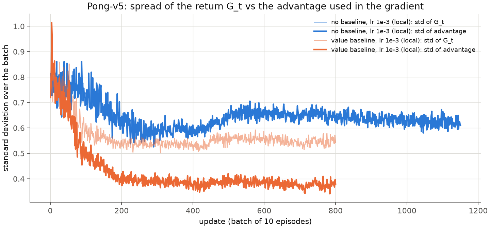{ width=80% }

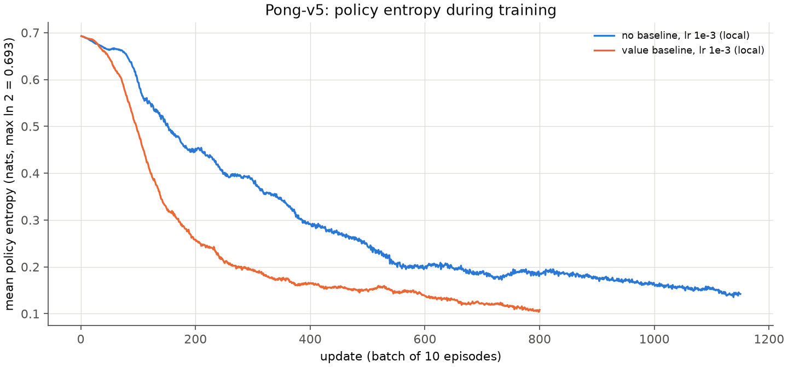{ width=78% }

## With three more months (Part 2)

- Measure the bias of the value baseline when the value network is fitted on the same episode that is used in the update (the implementation avoids this by using the pre-update network, but the alternative is common and its bias could be quantified by comparing the mean gradients over many episodes).
- Compare the variance and sample efficiency of the two baselines with reward-to-go only, with per-time-step baselines $b_t$, with normalised advantages, with generalised advantage estimation at several $\lambda$, and with a bootstrapped critic (actor-critic), all on the same seeds and budgets.
- Vary the capacity and the number of fitting steps of the value network to map how under- and over-fitting of $V_\phi$ changes the variance reduction and the final score.
- Run 5 or more seeds for Pong with and without the baseline and test the difference in the number of episodes to reach -15, -10 and 0 with a paired test across seeds.
- Try a shared trunk for policy and value on Pong and measure whether the value loss gradients help or hurt the policy features.
